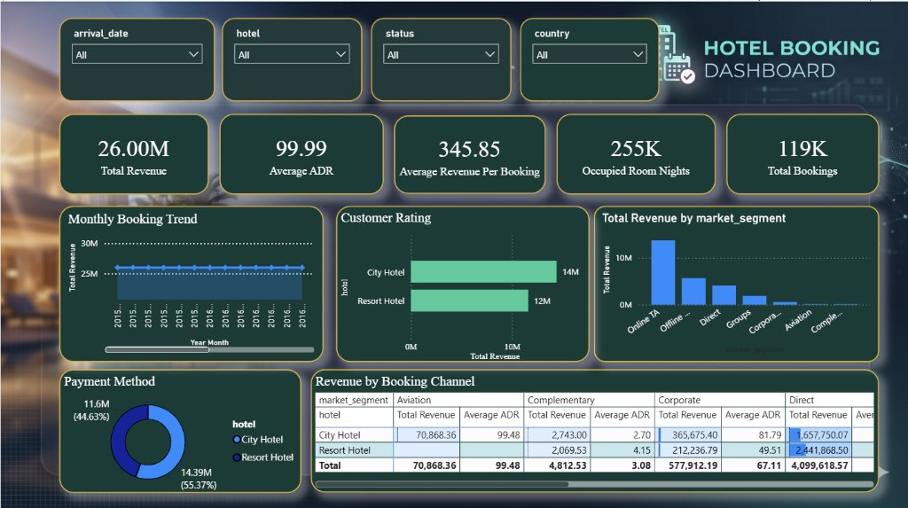
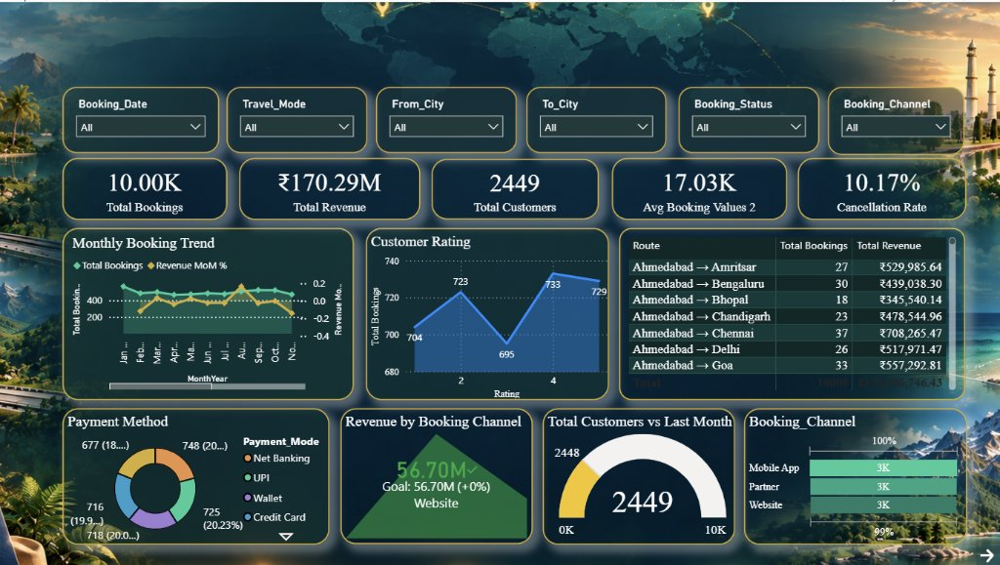

# 🏨 Project 30: Hotel Booking & Customer Reservation Analysis

An end-to-end data analytics project that explores **119,390 hotel booking records** to uncover trends in occupancy, revenue, cancellations, and customer behaviour. The insights are delivered through an interactive web dashboard backed by a FastAPI server and MySQL database, with supplementary analysis in Power BI.

---

## 📊 Power BI Dashboard Previews

### Dashboard View 1: Hotel Booking Analytics


### Dashboard View 2: Customer & Booking Operations


---

## 📂 Folder Structure

```
DA Project/
├── data/                → Raw dataset (hotel_bookings.csv)
├── sql/                 → MySQL schema, queries & analytical tasks
├── python/              → EDA pipeline, data cleaning & MySQL loader scripts
├── backend/             → FastAPI REST API (app.py)
├── frontend/            → Single-page dashboard (HTML / CSS / JS)
├── reports/             → Executive report, statistical summary & cleaned data
├── charts/              → Pre-generated EDA visualisations (10 PNGs)
├── powerbi/             → Power BI reports (DA_BI.pbix) & dashboard screenshots
├── start_backend.bat    → One-click script to launch the backend server
└── README.md            → This file
```

---

## 🚀 How to Run

### Prerequisites
| Tool | Purpose |
|------|---------|
| **Python 3.10+** | Backend & data scripts |
| **MySQL 8.x** | Database engine |
| **Power BI Desktop** | Optional — open `powerbi/DA_BI.pbix` |

### Steps

1. **Start MySQL** and ensure the `hotel_bookings_db` database is loaded.  
   If starting fresh, run the schema script:
   ```bash
   mysql -u root -p < sql/mysql_schema_and_queries.sql
   ```
   Then load the data:
   ```bash
   python python/load_data_to_mysql.py
   ```

2. **Install Python dependencies** (one-time):
   ```bash
   pip install fastapi uvicorn mysql-connector-python
   ```

3. **Launch the backend server:**
   ```bash
   start_backend.bat
   ```
   Or manually:
   ```bash
   python -m uvicorn backend.app:app --host 127.0.0.1 --port 8000 --reload
   ```

4. **Open the dashboard** in your browser:  
   👉 **http://127.0.0.1:8000**

---

## 🛠️ Tech Stack

| Layer | Technology |
|-------|------------|
| **Backend** | Python · FastAPI · Uvicorn |
| **Database** | MySQL 8 |
| **Frontend** | HTML5 · CSS3 · JavaScript · Chart.js |
| **BI Tool** | Microsoft Power BI |

---

## 📊 Key KPIs

| KPI | Description |
|-----|-------------|
| **Total Bookings** | Total number of reservation records |
| **Occupancy Rate** | Percentage of bookings that were not cancelled |
| **Total Revenue** | Sum of revenue across all bookings |
| **Avg Stay Duration** | Average total nights per booking |
| **Cancellation Rate** | Percentage of bookings that were cancelled |
| **Avg Room Price** | Average daily rate (ADR) across all bookings |

---

## 📈 Dashboard Pages

| Page | Highlights |
|------|-----------|
| **Overview** | KPI cards, monthly trends, room type & channel charts |
| **Revenue** | Revenue trends, hotel comparison, room-type revenue |
| **Occupancy** | Stay duration distribution, lead-time analysis |
| **Cancellations** | Cancellation breakdown by hotel, deposit type, customer type |
| **Customers** | Top nationalities, market segments, repeat-guest analysis |
| **Seasonal Trends** | Month-wise booking volume, ADR & revenue patterns |
| **Power BI** | Embedded Power BI report viewer |

---

## 📄 Reports

- **Hotel_Booking_Executive_Report.pdf** — High-level executive summary
- **Hotel_Booking_Statistical_Summary.txt** — Detailed statistical overview
- **Business_Insights_Report.txt** — Actionable business insights
- **Cleaned_Hotel_Bookings.csv** — Processed dataset after cleaning

---

> **Project 30** · Data Analytics Portfolio · Built with ❤️
